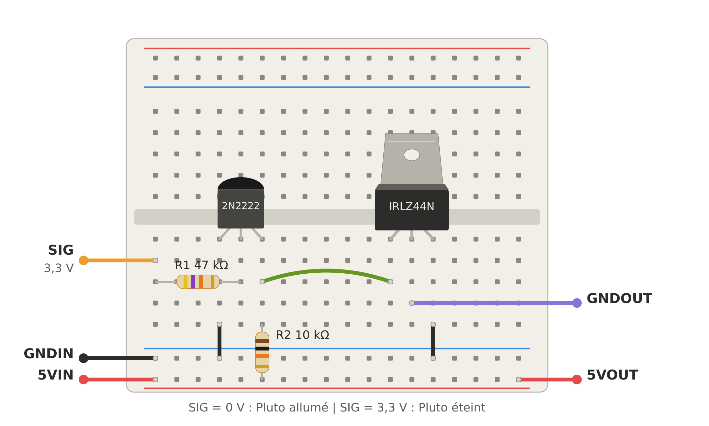

# Commutation de l'alimentation d'un PlutoSDR (ESP8266 / Raspberry Pi)

Allumer et éteindre un ADALM-PLUTO (PlutoSDR) depuis un GPIO 3,3 V, avec des
composants traversants : un **2N2222** (NPN) et un **IRLZ44N** (MOSFET canal N)
qui coupe la masse du Pluto.

## Principe

| SIG (GPIO) | 2N2222 | Grille IRLZ44N | PlutoSDR |
|---|---|---|---|
| 0 V | bloqué | ≈ 5 V (via R2 10 kΩ) | **allumé** |
| 3,3 V | passant | ≈ 0 V | **éteint** |

Le 2N2222 permet d'appliquer 5 V sur la grille (au lieu de 3,3 V), ce qui ouvre
complètement l'IRLZ44N. La logique est inversée : elle est gérée dans le code.

## Composants

- 2N2222 (PN2222A, brochage E-B-C face plate devant — vérifier selon le fabricant)
- IRLZ44N (brochage G-D-S face au marquage)
- R1 = 47 kΩ (base du 2N2222), R2 = 10 kΩ (collecteur vers +5 V)
- **Pas** de résistance entre grille et source (elle formerait un diviseur avec R2)

## Câblage

- 5VIN → 5VOUT (direct) → + du Pluto
- GNDOUT (drain IRLZ44N) → − du Pluto
- Source IRLZ44N, émetteur 2N2222, GND de l'ESP8266 → GNDIN
- Ne pas brancher le câble USB données du Pluto pendant cette commande (la masse contournerait le MOSFET)

## Contenu du dépôt

| Dossier | Contenu |
|---|---|
| `sim/` | Simulation ngspice du montage (lancée automatiquement par GitHub Actions) |
| `ltspice/` | Schéma LTspice équivalent |
| `firmware/esp8266_pluto/` | Code Arduino pour ESP8266 (D4, logique inversée) |
| `docs/` | Schéma de câblage sur plaque d'essai (PNG, SVG) |

## Simulation

La GitHub Action [`simulation.yml`](.github/workflows/simulation.yml) installe
ngspice, simule le montage (IRLZ44N nominal et pire cas), trace les courbes et
vérifie automatiquement que :

- le Pluto reçoit plus de 4,5 V quand il est allumé ;
- il reçoit moins de 0,5 V quand il est éteint ;
- la chute drain-source reste sous 0,1 V.

Résultats : onglet **Actions** → dernière exécution → résumé et artefact
`resultats-simulation` (courbes `resultats.png`).

Le modèle de l'IRLZ44N est une approximation VDMOS calée sur la datasheet. Pour
un résultat plus fidèle, utiliser le modèle SPICE officiel d'Infineon.
